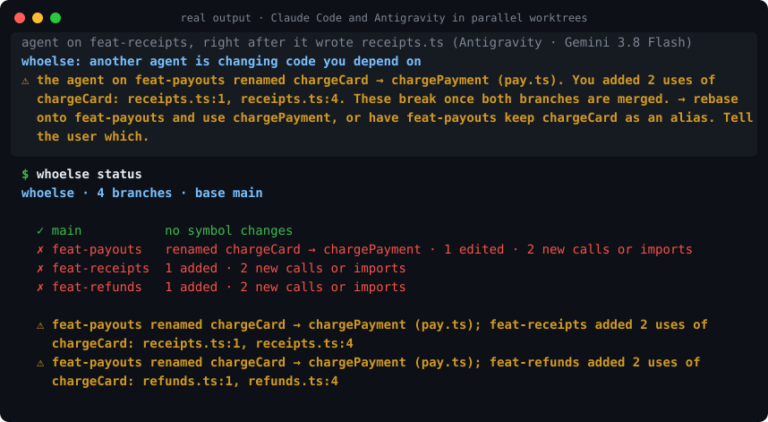

# whoelse

**Parallel coding agents merge cleanly and still break each other. whoelse tells them while they can still adapt.**

[](https://github.com/suryanshranjan/whoelse/actions/workflows/ci.yml)
[](https://www.npmjs.com/package/whoelse)
[](LICENSE)




You run three agents in three worktrees. Agent A renames `chargeCard` to `chargePayment`. Agent B, on another branch, writes new code that calls `chargeCard`. Both branches merge without a single conflict, and the build breaks. Git compares text, not meaning, and worktree tools keep agents apart without ever looking at what they changed.

whoelse reads every worktree of your repo at the symbol level. The moment one agent's work stops fitting another's, the affected agent is told, in its own context, mid-task:

- **removed or renamed**: another branch removed or renamed a function, class or type that your new code uses
- **signature changed**: another branch changed a function's parameters and your new calls no longer fit
- **both edited**: two branches changed the same function (heads-up, likely conflict)
- **both added**: two branches added the same name (two agents building the same thing)

Before an agent finishes, a hard clash holds it once, so it reports the problem to you instead of declaring success. An agent that keeps the old name alive (`export { chargePayment as chargeCard }`, `chargeCard = charge_payment`) clears the clash.

```
npx whoelse init     # once per machine
git worktree add ../feat-refunds -b feat-refunds
# ...run your agents in their worktrees as usual...
npx whoelse status   # every branch, what it changed, every clash
```

## How it works

1. `whoelse init` adds hooks to Claude Code (`~/.claude/settings.json`) and Codex (`~/.codex/hooks.json`) for your user, so fresh worktrees are covered without setup. Antigravity reads hooks from the repo, so it writes `.agents/hooks.json`; commit it. `--project` writes repo files for all three instead.
2. After an edit (and on each new prompt) the hook finds the worktree it runs in and reads every worktree's changes since it forked from the base branch: committed, staged, unstaged and untracked. It parses old and new versions with tree-sitter and diffs the symbols: removed, renamed, re-signatured, edited, added, and which calls and imports are new.
3. It compares this worktree with every other one and tells the agent about clashes it has not heard about yet (Claude Code and Codex: `additionalContext`; Antigravity: an ephemeral message before the next model call).
4. At Stop, a hard clash holds the agent once (`decision: block` / `continue`).

It reads other worktrees straight from disk, so it also sees work from agents without hooks (Cursor, an editor, you). No daemon, no server, no network, no model calls. Shared state is one small file per worktree in the common git dir.

## In CI

`whoelse check` exits 1 on a hard clash. Given branch names it compares their committed tips, so a pull request can be checked against the other open branches:

```yaml
- uses: actions/checkout@v4
  with:
    fetch-depth: 0   # all branches and history, for merge-base
- run: npx whoelse check origin/feat-payouts origin/${{ github.head_ref }}
```

## Commands

```
whoelse init [--project]   install hooks (Claude Code, Codex, Antigravity)
whoelse status [--json]    every worktree, what it changed, every clash
whoelse check [branch...]  same as a gate: exit 1 on a hard clash
whoelse doctor             is everything wired up?
```

The base branch is origin's default branch, else `main`/`master`; set another with `git config whoelse.base <branch>`.

## Status

Early, and tested live, not only in unit tests:

- **Claude Code**: agent B was told about agent A's rename right after writing the file, and reported it with the lines to fix.
- **Antigravity** (Gemini 3.8 Flash): the warning arrived before its next model call, Stop held it once, and its final reply flagged the clash.
- **Codex**: warned mid-task, it kept the old name alive with `export { chargePayment as chargeCard }`. That run also found a false alarm (an alias did not count as keeping the name), since fixed. Trust the hooks once with `/hooks` inside Codex.

Languages: TypeScript, TSX, JavaScript, Python. Not yet: type-level clashes (changed return types, interface fields), other languages.

From the maker of [askwhy](https://github.com/suryanshranjan/askwhy), which records why each agent change was made and whether it was tested.

## License

Apache-2.0. Bundled tree-sitter grammars are MIT; see [grammars/NOTICE.md](grammars/NOTICE.md).
